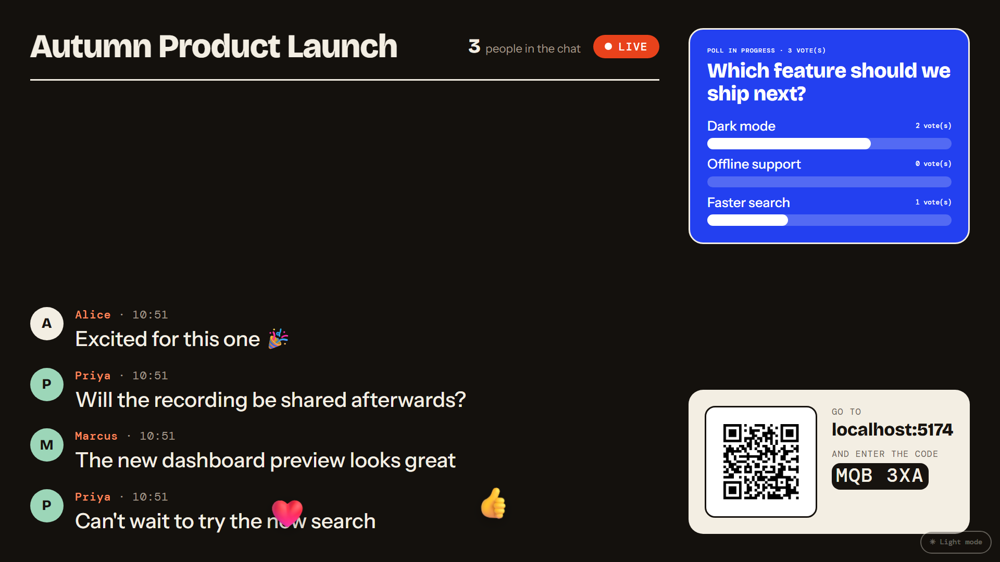
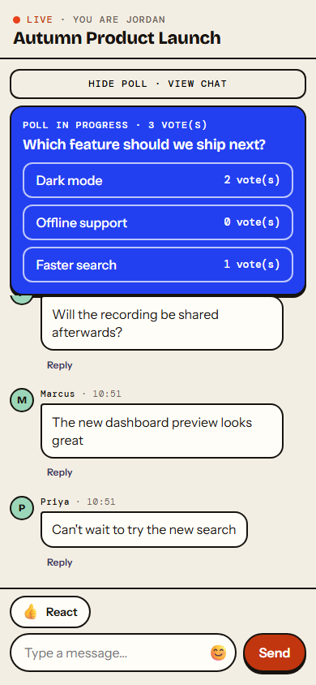
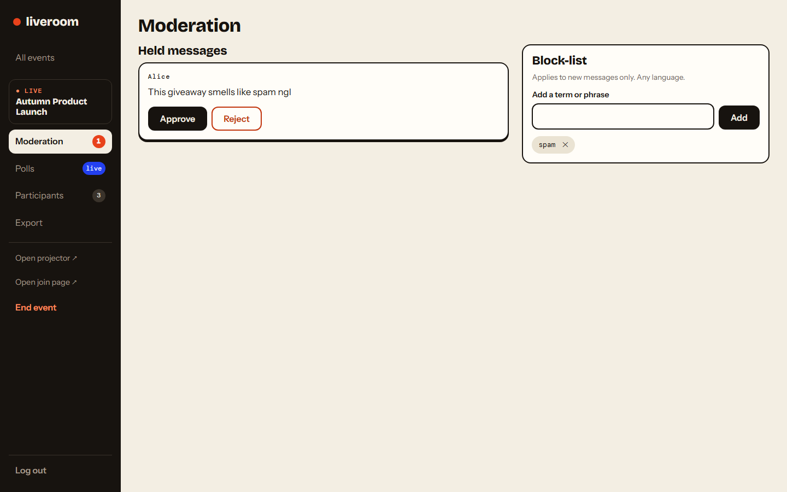
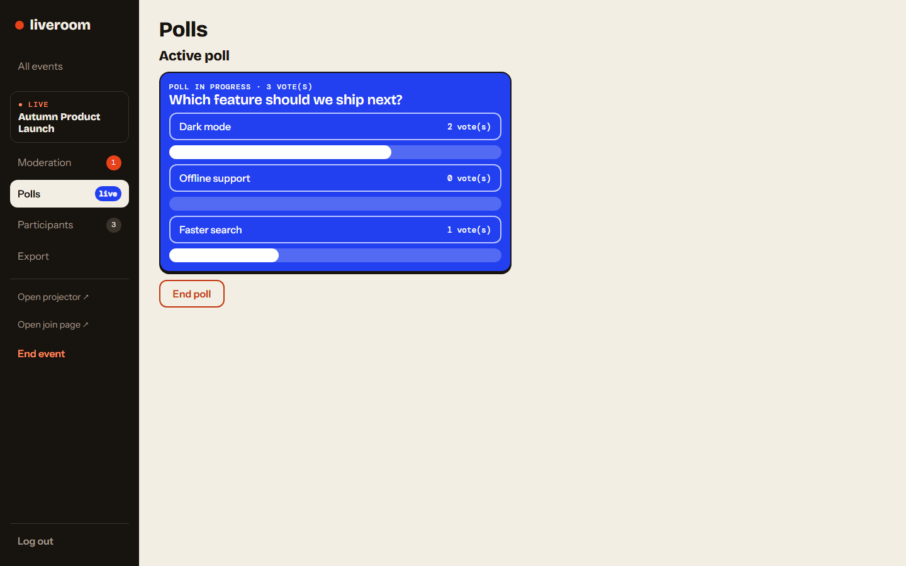

# Live Chat

A shared, moderated real-time chat for hybrid (in-room + remote) events: participants
join via a QR code or link and post under a display name; a projected screen shows
the same chat live; a moderator holds a block-list-based moderation queue, runs
live polls, and can export the event's chat to a CSV file.

Built per the spec in [`specs/001-hybrid-event-chat/`](specs/001-hybrid-event-chat/)
— see `spec.md` for requirements, `plan.md` for the technical approach, and
`tasks.md` for the implementation breakdown. There is no AI/LLM dependency (see the
spec's Clarifications → "Amendment 2026-10-24").

## Screenshots

| Projector | Participant chat |
|---|---|
|  |  |

| Moderation queue | Live poll |
|---|---|
|  |  |

## Stack

TypeScript throughout: React + Vite frontend, [Convex](https://convex.dev) for the
backend (reactive datastore + serverless functions), no separate server to run.

## Setup

```bash
npm install
npx convex dev        # provisions/links a Convex dev deployment, generates convex/_generated
npm run dev            # starts the Vite dev server
```

Both commands need to keep running (two terminals) during development.

## Scripts

| Command | What it does |
|---|---|
| `npm run dev` | Vite dev server |
| `npm run build` | Production frontend build |
| `npm run typecheck` | `tsc --noEmit` across `src/`, `convex/`, `e2e/`, `tests/` |
| `npm run lint` | ESLint |
| `npm run test:unit` | Vitest — frontend unit/component tests (`src/**/*.test.tsx`) |
| `npm run test:convex` | Vitest + `convex-test` — backend contract tests (`tests/convex/`) |
| `npm run test:e2e` | Playwright — multi-client sync, moderation, polls, export, accessibility (`e2e/`) |

`npm run test:e2e` starts its own Convex and Vite dev servers (see
`playwright.config.ts`) — you don't need to start them by hand first.

## Manual validation

See [`specs/001-hybrid-event-chat/quickstart.md`](specs/001-hybrid-event-chat/quickstart.md)
for a scenario-by-scenario walkthrough of every user story, plus a keyboard-only
accessibility smoke check.

## Load check

`npm run loadcheck` (with `npx convex dev` already running) simulates ~150
concurrent participants joining and sending one message each against the local
backend, to spot-check SC-001/SC-002/SC-003 at the target scale. Not part of the
automated test suite — a manual utility for re-verifying scale assumptions later.

## First moderator account

There's no sign-up flow — the single v1 moderator account is created once via the
guarded `auth.bootstrapModerator` mutation (see `convex/auth.ts`), then logged into
from `/admin/login`.
